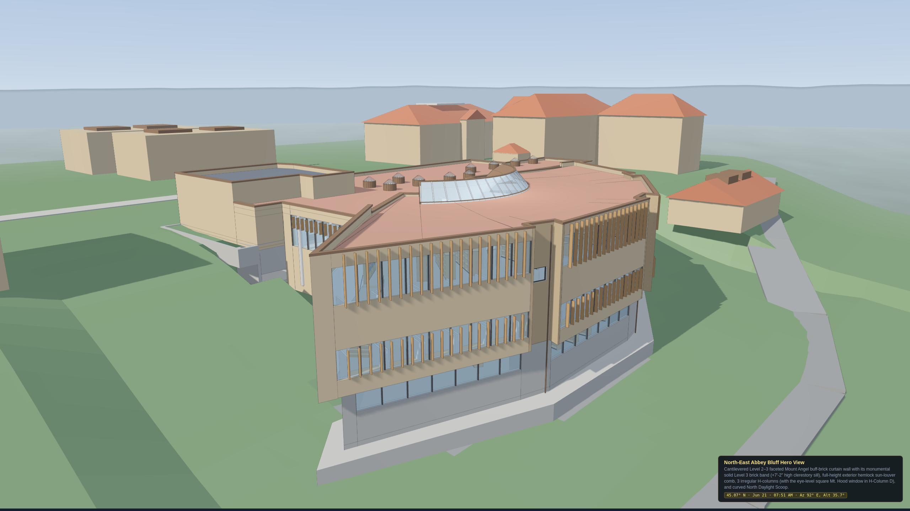

# Mount Angel Abbey Library — Alvar Aalto (1970)

**A digital reconstruction of the library, built from Aalto's original drawings.**



Fr. Barnabas Reasoner travelled to Helsinki to ask Alvar Aalto to design a new library for the Abbey. The building Aalto gave us was dedicated in 1970. From the quad it looks like a low brick pavilion. Behind that, it opens into a fan of reading rooms that steps down the north bluff around a sunken reading well, lit by a curved skylight.

This project rebuilds that library digitally. Working from Aalto's 47 original drawing sheets and from photographs, we made an accurate 3D model that anyone can explore in a web browser. We also made a printable visitor guide and a record of how the work was done.

### ➜ Visit the site: **[phiarchitect.github.io/mount_angel](https://phiarchitect.github.io/mount_angel/)**

Nothing needs to be installed. The site works in any modern web browser.

---

## What you will find

| Page | What it is for |
|---|---|
| **[3D Model](https://phiarchitect.github.io/mount_angel/library-3d.html)** | Walk around and through the library. Cut it open to see the levels and set the sun to any day and hour. Press **F** for full screen and **M** to hide the menus. |
| **[The Journey](https://phiarchitect.github.io/mount_angel/journey.html)** | Fr. Barnabas's March 1966 trip to meet Aalto: a map, the buildings he saw, and his hopes for the library. |
| **[Making the Model](https://phiarchitect.github.io/mount_angel/making-of.html)** | How the drawings were read and measured, and what we learned about Aalto's design along the way. |
| **[Building with Code](https://phiarchitect.github.io/mount_angel/code.html)** | How Python functions and IngeTrazo built the 3D forms, with early passes and bugs caught along the way. |
| **[Furniture & Lamps](https://phiarchitect.github.io/mount_angel/furniture.html)** | Each of Aalto's custom pieces — the parapet-mounted mushroom lamp, cantilevered linoleum workbench, Artek seating, and birch bookcases — observed from photographs and built in code. |
| **[Photo vs. Model](https://phiarchitect.github.io/mount_angel/photo-compare.html)** | Eight photographs of the library set beside matching views of the model, so you can judge its accuracy for yourself. |
| **[Blueprints](https://phiarchitect.github.io/mount_angel/drawings.html)** | All 47 of Aalto's sheets (plans, sections, details, furniture and structure) in one place. |
| **[Visitor Guide](https://phiarchitect.github.io/mount_angel/visitor-guide.html)** | A fold-out rack card and lobby posters with floor plans, a section through the skylight and a campus map, ready to print. |

## For the library and the Abbey

Some ways this work might be useful:

- **Welcoming visitors.** Print the rack card for the entry desk and the posters for the lobby. The model views can also go on screens or in talks.
- **Teaching and tours.** The 3D model shows things that are hard to see in person: the whole building at once, how the three levels fit together, and how daylight moves through the reading room over the seasons.
- **Stewardship.** The model and the measured drawings are a record of the building as Aalto designed it. That record can help with care, repairs and future planning. Please note that it is a study model. Before any construction work, confirm dimensions on site and against the original drawings.
- **The archive.** All 47 drawing sheets are browsable in one place, alongside Fr. Barnabas's 1966 report on his Helsinki journey.

Corrections are welcome. If you notice anything in the model that doesn't match the building (a wall, a stair, a window, a bookcase), please let us know. Many of the details so far have come from exactly this kind of careful looking.

## Sources and thanks

- **Alvar Aalto's drawings**: architectural, structural and furniture sheets for Mount Angel Abbey Library.
- **Fr. Barnabas Reasoner, O.S.B.**: his report on the commission (`references/documents/Barnabas-Report.pdf`).
- **Photographs and images**: Mount Angel Abbey's website ([mountangelabbey.org](https://www.mountangelabbey.org)). Each source is listed in [`references/references.md`](references/references.md).

All drawings and photographs remain the property of their owners. They are used here for study and documentation.

Made by **phi ARCHITECT**. Release history is in the [CHANGELOG](CHANGELOG.md). This is version 0.7.0.

---

## Technical notes (for maintainers)

Everything below is for anyone updating the model or the website.

### How it fits together

1. **Measuring the drawings**: [`src/phiarchitect/mountangel/vectors.py`](src/phiarchitect/mountangel/vectors.py)
   - Every key sheet is scaled and aligned to one shared coordinate system. The origin is archival Working Point #3 (`0'-0"`, `0'-0"`) on the Level 3 floor and survey grid line 6, with `WP #2` (`+2'-10"`, `-5'-3"`) anchoring flanks A & E and `WP #3A` (`3'-9"` along Ray D) anchoring the circular Reading Well and North Daylight Scoop (+X east, +Y north, +Z up).
   - Seven sheets are registered: 03, 04, 05, 06, 07, 13 and S4.
   - The script writes vector overlays (`docs/overlays/sheet_*.svg`) and proof images (`docs/overlays/proofs/`).
2. **Building the 3D model**: [`ingetrazo_3d/`](ingetrazo_3d/)
   - Uses IngeTrazo (phi-WORKS) to build a watertight 10-layer model with 181,196 faces (`0` unpaired edges). The outputs are `mount_angel_library.igz`, `.obj` and `.mtl`, plus the componentized web scene manifest `docs/overlays/library_3d_scene.json` referencing reusable furniture prototypes (`docs/overlays/scene/components/*.json`) and per-layer JSONs (`docs/overlays/scene/layers/*.json`).
3. **The website**: [`docs/`](docs/)
   - Plain HTML, CSS and WebGL2, with no build step (`library-3d.html`, `library-3d.css`, `library-3d.js`). GitHub Pages serves it directly from `docs/`.
   - All pages share the header in `suite.css`.

### Model components (`ingetrazo_3d/components/`)

| Module | Builds |
|---|---|
| `regulating_lines.py` | Working points (`WP #3`, `WP #2`, `WP #3A`), structural rays A–E and the regulating arcs |
| `site_terrain.py` | Surveyed Abbey hilltop bluff, formal Quad walkways, mitered Abbey Drive, and all 8 surrounding campus buildings |
| `campus_trees.py` | 52 surveyed monumental hilltop trees (Cedars of Lebanon, 100-ft Giant Sequoias, Quad Copper Beeches & Oaks) |
| `lower_levels.py` | Levels 1 (`-28'-6"`), Level 2 (`-14'-0"`), the `-5'-4"` Mezzanine reference gallery (3-shelf bookwalls), retaining wall, and `10R+16R` flanking stairs |
| `level3_reading_room.py` | The Level 3 reading room (`0'-0"`), reading well rim, reading counter and lamps, control desk, 3-riser Lobby steps (`+1'-4"`), and periodical lounge |
| `aalto_bookcases.py` | Parametric Aalto bookcases for every level (3-shelf Mezzanine & stair counters, 6-shelf full-height stacks) |
| `south_wing_interiors.py` | Lobby, wood screen, restrooms, glazed office wall, rare-book vault and auditorium |
| `envelope_and_south_wing.py` | Brick curtain walls, hemlock sun louvers, irregular H-columns (B, C, D), columns and the entry canopy |
| `roof_and_skylights.py` | The three roof tiers and parapets, the `+21'-4"` north daylight scoop, `18WF50` header beams, wood-slatted ceiling, 14 conical skylights and 3 outer-fan exhaust fans |
| `primitives.py` | Shared mesh helpers and materials |

### Repository layout

```
src/phiarchitect/mountangel/   vectors, visitor guide & wayfinding generators
ingetrazo_3d/                  3D model build script, components and outputs
docs/                          the website (GitHub Pages)
  drawings/  photos/           source scans and photographs
  overlays/                    vector overlays, proofs, measuring grids, 3D scene
  renders/                     studio and photo-match renders
references/                    Barnabas report, source list, field verification guide, notes
build.py, scripts/, docs/model/  early FreeCAD blockout (superseded, kept for history)
```

### Common tasks

Use the uv-managed Python 3.13 and run these from the repository root.

**Preview the website locally**

```bash
python3 -m http.server 8080 --directory docs
# open http://localhost:8080/
```

**Regenerate the vector overlays and proofs**

```bash
uv run --no-project --with pillow --with numpy python3 -c "import sys; sys.path.insert(0, 'src'); from pathlib import Path; from phiarchitect.mountangel.vectors import export_all_overlays; export_all_overlays(Path('.'), Path('docs/overlays/proofs'))"
```

**Rebuild the 3D model.** This needs a local IngeTrazo checkout with its own virtual environment:

```bash
<ingetrazo>/.venv/bin/python ingetrazo_3d/build_ingetrazo_library.py              # model, web scene and studio renders
<ingetrazo>/.venv/bin/python ingetrazo_3d/build_ingetrazo_library.py --skip-web   # skip the studio render capture
<ingetrazo>/.venv/bin/python ingetrazo_3d/build_ingetrazo_library.py --live       # also push into a running IngeTrazo window
```

**Regenerate the visitor guide**

```bash
python3 -c "import sys; sys.path.insert(0, 'src'); from phiarchitect.mountangel.visitor_guide import write_visitor_guide; print(write_visitor_guide())"
```

**Studio renders.** The build script captures them automatically unless you pass `--skip-web`. You can reproduce any view from `library-3d.html` with its camera preset, for example `library-3d.html?cam=hillside_hero&studio=1&hud=0`. Renders are 2560×1440 and saved into `docs/renders/`.
